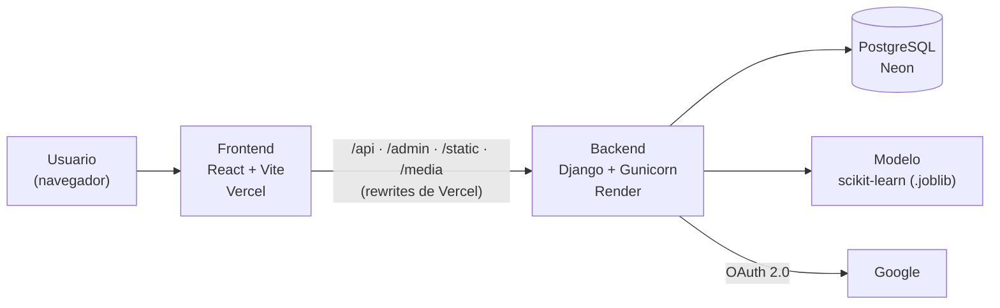

<div align="center">

# AirByte · Backend

**API y motor de pronóstico de calidad del aire (PM2.5) para Bogotá**

Django · PostgreSQL · scikit-learn · Google OAuth 2.0


[Aplicación en vivo](https://airbyte-eight.vercel.app) ·
[API](https://airbyte-backend.onrender.com/api/v1/estaciones) ·
[Repositorio del frontend](https://github.com/juandiegogalindo/AirByte-Frontend)

</div>

---

## Tabla de contenidos

1. [Descripción](#descripción)
2. [Características](#características)
3. [Arquitectura](#arquitectura)
4. [Tecnologías](#tecnologías)
5. [Estructura del repositorio](#estructura-del-repositorio)
6. [Datos y modelo predictivo](#datos-y-modelo-predictivo)
7. [API](#api)
8. [Instalación local](#instalación-local)
9. [Variables de entorno](#variables-de-entorno)
10. [Pruebas](#pruebas)
11. [Despliegue](#despliegue)
12. [Solución de problemas](#solución-de-problemas)
13. [Seguridad](#seguridad)
14. [Equipo](#equipo)

---

## Descripción

AirByte es una plataforma que permite consultar **qué tan contaminado está el aire en Bogotá** y anticipar cómo evolucionará durante las próximas 24 horas.

Este repositorio contiene el **backend**: un servidor Django que

- almacena y sirve las mediciones horarias de PM2.5 de la Red de Monitoreo de Calidad del Aire de Bogotá (RMCAB),
- ejecuta un modelo de aprendizaje automático para pronosticar la concentración de PM2.5,
- gestiona cuentas de usuario mediante inicio de sesión con Google,
- y ofrece los módulos de comunidad (comentarios y reportes) y de moderación.

El cliente web vive en un repositorio aparte: [AirByte-Frontend](https://github.com/juandiegogalindo/AirByte-Frontend).

## Características

- **Consulta por estación**: estado actual del aire en cada estación de monitoreo.
- **Pronóstico a 24 horas** de PM2.5 con un modelo entrenado con scikit-learn.
- **Histórico** de mediciones horarias (2019–2025) con más de 270 000 registros.
- **Autenticación con Google (OAuth 2.0)** mediante Authlib, con sesiones seguras y protección CSRF.
- **Comunidad**: comentarios y reportes de usuarios.
- **Moderación y sanciones** de cuentas desde el panel de administración.
- **Versionado de datasets**: cada conjunto de datos se registra con su código, huella `sha256` y fuente.

## Arquitectura



El frontend reenvía las rutas `/api`, `/admin`, `/static` y `/media` al backend. Como el navegador solo habla con un único origen, **no se requiere configurar CORS** y las cookies de sesión funcionan sin ajustes adicionales.

## Tecnologías

| Capa | Tecnología |
| --- | --- |
| Lenguaje | Python 3.12 |
| Framework web | Django 6.1 |
| Base de datos | PostgreSQL (Neon en producción) con `psycopg` 3 |
| Autenticación | Google OAuth 2.0 con Authlib |
| Machine learning | scikit-learn 1.6.1, pandas 2.2.3, numpy 2.0.2, joblib 1.4.2 |
| Servidor de aplicación | Gunicorn |
| Archivos estáticos | WhiteNoise |
| Despliegue | Render (backend), Neon (base de datos), Vercel (frontend) |

## Estructura del repositorio

```text
AirByte-Backend/
├── backend/                 # Proyecto Django
│   ├── config/              # Configuración, URLs, WSGI y middlewares
│   ├── aire/                # Estaciones, localidades, mediciones y pronóstico
│   ├── comunidad/           # Comentarios y reportes
│   ├── cuentas/             # Perfiles, identidad de Google y sanciones
│   ├── templates/           # Plantillas (páginas de error)
│   ├── manage.py
│   ├── requirements.txt     # Dependencias de la aplicación
│   └── requirements.lock
├── datos/RMCAB/             # Datos de origen de la red de monitoreo
├── db-scripts/              # Scripts de PowerShell y SQL para la base local
├── modelo/                  # Artefactos del modelo entrenado (.joblib)
├── notebooks/               # Notebook de entrenamiento y requisitos de inferencia
├── scripts/                 # Utilidades auxiliares
├── docs/                    # Documentación
├── .env.example             # Plantilla de variables de entorno
└── README.md
```

## Datos y modelo predictivo

**Fuente de datos.** Mediciones horarias de la RMCAB para cinco estaciones de Bogotá: Carvajal-Sevillana, Kennedy, Puente Aranda, Tunal y Usaquén, entre enero de 2019 y diciembre de 2025. En total, la base contiene más de **271 000 mediciones horarias**.

**Modelo.** El pronóstico de PM2.5 a 24 horas se entrena en el notebook [`notebooks/air_byte.ipynb`](notebooks/air_byte.ipynb) y se exporta como archivos `.joblib` en [`modelo/`](modelo/):

| Archivo | Uso |
| --- | --- |
| `air_byte_pm25_24h_historial.joblib` | Modelo que se carga por defecto en el backend |
| `air_byte_pm25_24h.joblib` | Variante de pronóstico a 24 horas |
| `air_byte_pm25_horario.joblib` | Variante de pronóstico horario |

La ruta del modelo se puede cambiar con la variable `AIRBYTE_MODEL_PATH`. Las versiones de `scikit-learn`, `numpy` y `joblib` están fijadas en `notebooks/requirements.txt` para que coincidan con las usadas durante el entrenamiento; **no las actualices sin volver a exportar el modelo**.

> AirByte es un proyecto informativo y académico. Para decisiones de salud o de política pública, consulta siempre las fuentes oficiales de la autoridad ambiental.

## API

Las rutas se publican bajo el prefijo `/api/v1/`.

| Método | Ruta | Descripción |
| --- | --- | --- |
| `GET` | `/api/v1/estaciones` | Lista de estaciones con su localidad, coordenadas y rango de datos disponible |
| `GET` | `/api/v1/actual?estacion=<slug>` | Estado actual y pronóstico de una estación |
| `GET` | `/api/v1/sesion` | Estado de la sesión del usuario |
| `GET` | `/api/v1/auth/google/callback` | Retorno del flujo OAuth con Google |

Los *slugs* de estación válidos son `carvajal-sevillana`, `kennedy`, `puente-aranda`, `tunal` y `usaquen`.

Ejemplo:

```bash
curl "https://airbyte-backend.onrender.com/api/v1/estaciones"
```

```json
{
  "resultados": [
    {
      "slug": "tunal",
      "nombre": "Tunal",
      "localidad": "tunjuelito",
      "localidad_nombre": "Tunjuelito",
      "latitud": 4.576225,
      "longitud": -74.130956,
      "desde": "2019-01-01T01:00:00-05:00",
      "hasta": "2025-12-31T23:00:00-05:00"
    }
  ]
}
```

El resto de endpoints (histórico, comunidad, perfil y moderación) se encuentra en los archivos `urls.py` de cada aplicación. El panel de administración de Django está disponible en `/admin/`.

## Instalación local

### Requisitos

- Python **3.12**
- PostgreSQL **14 o superior**
- Git
- Credenciales OAuth de Google (solo si vas a probar el inicio de sesión)

### Pasos

```powershell
# 1. Clonar el repositorio
git clone https://github.com/juandiegogalindo/AirByte-Backend.git
cd AirByte-Backend

# 2. Crear y activar el entorno virtual
python -m venv .venv
.\.venv\Scripts\Activate.ps1          # Windows (PowerShell)
# source .venv/bin/activate           # Linux / macOS

# 3. Instalar dependencias
pip install -r backend/requirements.txt

# 4. Configurar variables de entorno
Copy-Item .env.example .env           # Linux / macOS: cp .env.example .env
# Edita .env con tus valores (ver la sección «Variables de entorno»)
```

**5. Preparar la base de datos.** Los scripts de [`db-scripts/`](db-scripts/) (`crear-base.ps1`, `poblar-base.ps1` y `eliminar-base.ps1`) automatizan la creación y la carga de datos en una instancia local de PostgreSQL. Sigue las instrucciones de [`db-scripts/README.md`](db-scripts/README.md).

```powershell
# 6. Aplicar las migraciones
python backend/manage.py migrate

# 7. Iniciar el servidor de desarrollo
python backend/manage.py runserver
```

La API queda disponible en <http://127.0.0.1:8000/api/v1/estaciones>.

Para usar la interfaz web en local, levanta también el [frontend](https://github.com/juandiegogalindo/AirByte-Frontend) (`npm run dev`): su servidor de desarrollo redirige `/api` hacia este backend.

## Variables de entorno

El archivo `.env` se carga desde la raíz del repositorio. **Nunca lo subas a Git**: ya está incluido en `.gitignore`.

| Variable | Obligatoria | Valor por defecto | Descripción |
| --- | :---: | --- | --- |
| `DJANGO_SECRET_KEY` | ✅ | — | Clave secreta de Django. Genera una única por entorno. |
| `DJANGO_DEBUG` | | `0` | `1` activa el modo depuración. Debe ser `0` en producción. |
| `DJANGO_ALLOWED_HOSTS` | | `localhost,127.0.0.1` | Hosts permitidos, separados por comas y sin espacios. |
| `DJANGO_CSRF_TRUSTED_ORIGINS` | | — | Orígenes de confianza para CSRF (con `https://`), separados por comas. |
| `PGHOST` | | `127.0.0.1` | Host de PostgreSQL. |
| `PGPORT` | | `5432` | Puerto de PostgreSQL. |
| `PGDATABASE` | | `airbyte` | Nombre de la base de datos. |
| `PGUSER` | | `airbyte` | Usuario de la base de datos. |
| `PGPASSWORD` | | — | Contraseña de la base de datos. |
| `PGSSLMODE` | | — | Usa `require` para conexiones a Neon. |
| `GOOGLE_CLIENT_ID` | | — | ID de cliente OAuth de Google. |
| `GOOGLE_CLIENT_SECRET` | | — | Secreto del cliente OAuth. |
| `GOOGLE_REDIRECT_URI` | | `http://localhost:5173/api/v1/auth/google/callback` | URI de retorno registrada en Google Cloud. |
| `FRONTEND_URL` | | `http://localhost:5173` | URL pública del frontend. |
| `AIRBYTE_HISTORICO` | | `rmcab-v1` | Código de la versión del dataset histórico en uso. |
| `AIRBYTE_MODEL_PATH` | | `modelo/air_byte_pm25_24h_historial.joblib` | Ruta del modelo de pronóstico. |

Ejemplo mínimo para desarrollo:

```dotenv
DJANGO_SECRET_KEY=cambia-esto-por-una-clave-larga-y-aleatoria
DJANGO_DEBUG=1
PGHOST=127.0.0.1
PGPORT=5432
PGDATABASE=airbyte
PGUSER=airbyte
PGPASSWORD=tu-contraseña-local
```

Para generar una clave secreta:

```bash
python -c "from django.core.management.utils import get_random_secret_key as g; print(g())"
```

## Pruebas

```powershell
python backend/manage.py test
```

## Despliegue

El backend se despliega en **Render**, la base de datos vive en **Neon** y el frontend en **Vercel**.

### 1. Base de datos en Neon

1. Crea un proyecto en [Neon](https://neon.tech) en la misma región que tu servicio de Render (en este proyecto, AWS US East 2, Ohio).
2. Copia los datos de conexión de la rama `production` usando la conexión **directa** (sin `-pooler` en el host).
3. Configura `PGHOST`, `PGDATABASE`, `PGUSER`, `PGPASSWORD` y `PGSSLMODE=require`.

### 2. Servicio web en Render

| Campo | Valor |
| --- | --- |
| Repositorio / rama | `AirByte-Backend` · `main` |
| Región | La misma de Neon (Ohio) |
| Root Directory | *(vacío; el modelo se busca desde la raíz del repo)* |
| Runtime | Python 3 |
| Build Command | `pip install -r backend/requirements.txt && python backend/manage.py collectstatic --noinput` |
| Start Command | `gunicorn --chdir backend config.wsgi:application --workers 1 --threads 2 --timeout 120` |

Variables de entorno adicionales en Render:

```dotenv
PYTHON_VERSION=3.12.10
DJANGO_DEBUG=0
DJANGO_ALLOWED_HOSTS=airbyte-backend.onrender.com,airbyte-eight.vercel.app
DJANGO_CSRF_TRUSTED_ORIGINS=https://airbyte-eight.vercel.app
GOOGLE_REDIRECT_URI=https://airbyte-eight.vercel.app/api/v1/auth/google/callback
FRONTEND_URL=https://airbyte-eight.vercel.app
```

más `DJANGO_SECRET_KEY`, las variables `PG*` y las credenciales de Google descritas arriba.

### 3. Inicio de sesión con Google

En [Google Cloud Console](https://console.cloud.google.com) crea un cliente OAuth de tipo **Aplicación web** y registra:

- **Orígenes de JavaScript autorizados**: `https://airbyte-eight.vercel.app` y `http://localhost:5173`
- **URIs de redireccionamiento autorizados**:
  `https://airbyte-eight.vercel.app/api/v1/auth/google/callback` y
  `http://localhost:5173/api/v1/auth/google/callback`

Para que cualquier cuenta de Google pueda entrar, publica la aplicación en *Google Auth Platform → Público*. Con los permisos básicos (`openid`, correo y perfil) no se requiere verificación adicional.

### Limitaciones del plan gratuito

- Render **suspende el servicio tras ~15 minutos sin tráfico**; la primera petición puede tardar cerca de un minuto en responder.
- El disco de Render es efímero: los archivos subidos a `MEDIA_ROOT` (por ejemplo, fotos de perfil) se pierden en cada reinicio o redespliegue. Para conservarlos, usa un almacenamiento externo (S3, Cloudinary, etc.).

## Solución de problemas

| Síntoma | Causa probable y solución |
| --- | --- |
| `Error 400: redirect_uri_mismatch` | El URI de retorno enviado no coincide, carácter por carácter, con uno registrado en Google Cloud. Revisa `GOOGLE_REDIRECT_URI` y la lista de URIs autorizados. |
| `DisallowedHost` / respuesta 400 | Falta el dominio en `DJANGO_ALLOWED_HOSTS`. Sepáralos con comas y **sin espacios**. |
| `CSRF verification failed` | Agrega el origen del frontend (con `https://`) a `DJANGO_CSRF_TRUSTED_ORIGINS`. |
| Error de conexión SSL a la base | Define `PGSSLMODE=require` y usa el host directo de Neon. |
| `KeyError: 'DJANGO_SECRET_KEY'` | Falta la variable de entorno o el archivo `.env` no está en la raíz del repositorio. |
| El modelo no carga o da error de versión | Verifica que `scikit-learn`, `numpy` y `joblib` coincidan con `notebooks/requirements.txt` y que uses Python 3.12. |
| El despliegue en Render falla al instalar | Confirma `PYTHON_VERSION=3.12.10` y que `gunicorn` figure en `backend/requirements.txt`. |
| La primera carga tarda mucho | Es el arranque en frío del plan gratuito de Render. |

## Seguridad

- Mantén fuera de Git el `.env`, las claves y las contraseñas. Solo se versiona `.env.example`.
- Usa una `DJANGO_SECRET_KEY` distinta en cada entorno y `DJANGO_DEBUG=0` en producción.
- Con `DJANGO_DEBUG=0`, las cookies de sesión y CSRF se marcan como `Secure`.
- Si una credencial se expone por accidente, **rótala de inmediato** (nuevo secreto en Google Cloud, `Reset password` en Neon, nueva clave de Django).

## Equipo
Proyecto desarrollado por los participantes en la Universidad Piloto de Colombia (2026-2).
- **Juan Diego Galindo Montenegro** — [@juandiegogalindo](https://github.com/juandiegogalindo)
- **Cristian Cortes Bejarano** — [@CristianCortes1](https://github.com/CristianCortes1).

Datos de calidad del aire: Red de Monitoreo de Calidad del Aire de Bogotá (RMCAB).
